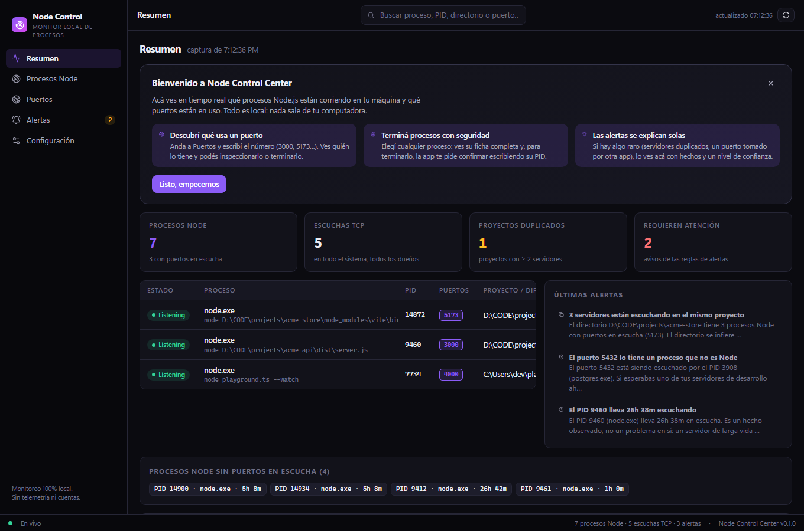
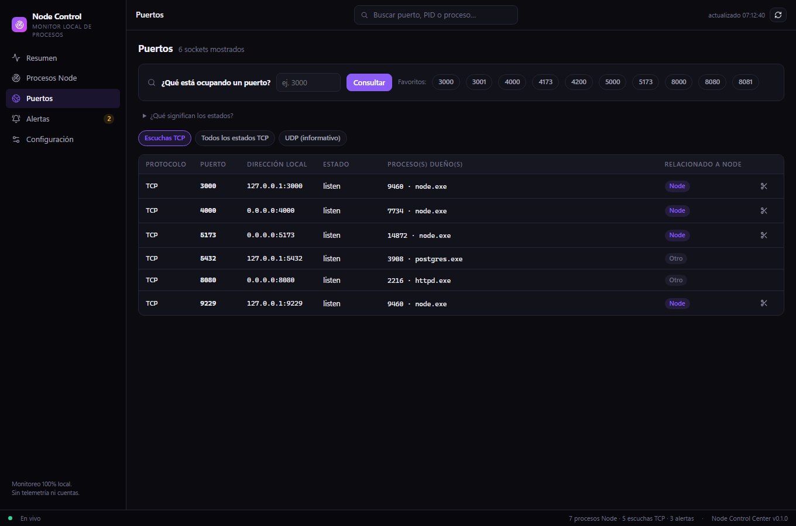
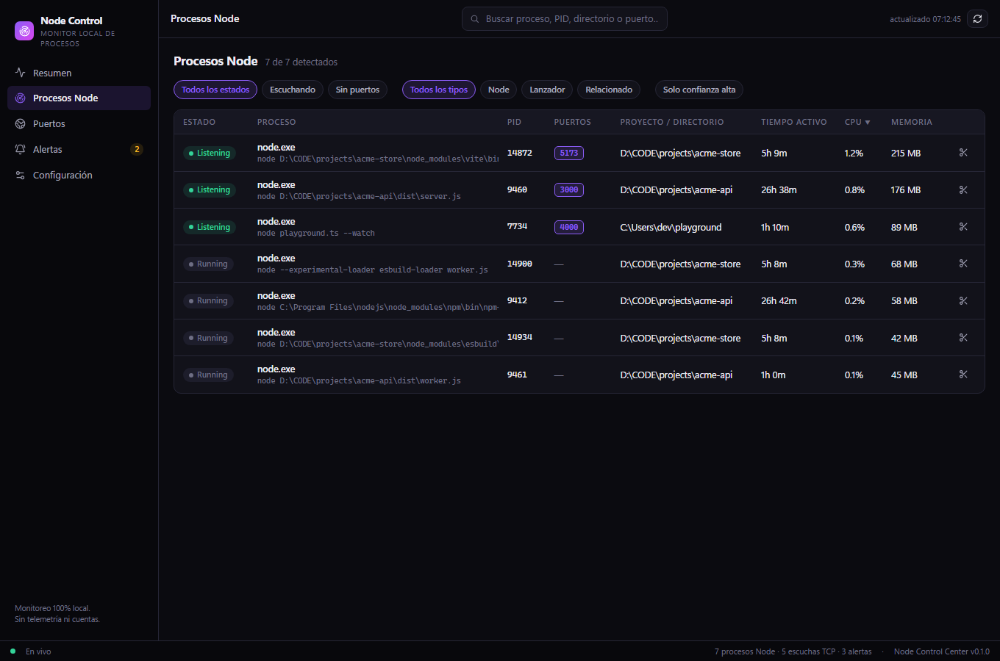
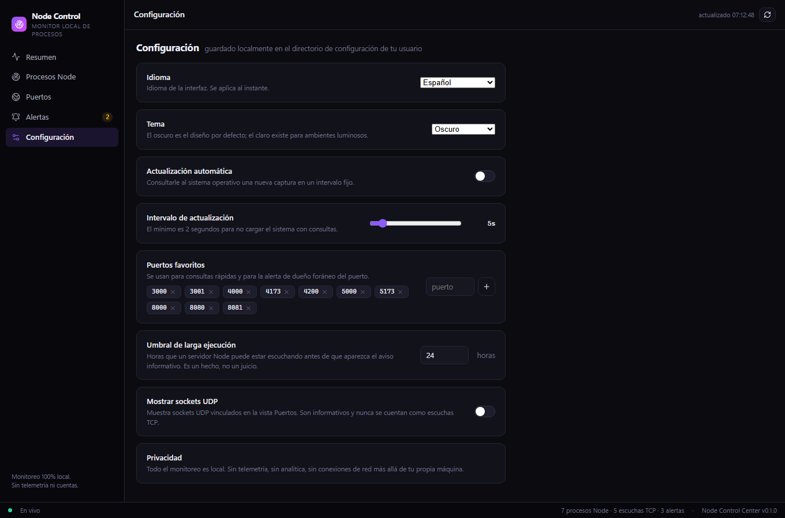

<div align="center">

# Node Control Center

**Mirá lo que realmente hacen tus procesos Node — local, lindo y seguro.**

Aplicación de escritorio premium para Windows que monitorea procesos Node.js, servidores de
desarrollo y puertos locales. Construida con Tauri 2, Rust, React y TypeScript.
Sin cuentas, sin telemetría, sin nube.

[](https://tauri.app)
[](https://www.rust-lang.org)
[](https://react.dev)
[](https://www.typescriptlang.org)
[](#notas-de-plataforma)

[Español](#por-qué) · [English](README.md)

</div>

---

## Por qué

Si trabajás con servidores de desarrollo, herramientas de IA y varios proyectos a la vez, conocés
la escena: *algo* está escuchando en el puerto 3000 pero no sabés qué. El Administrador de tareas
te muestra un montón de `node.exe` sin contexto. Node Control Center responde las preguntas que
de verdad hacés:

- ¿Qué procesos Node están corriendo y de qué proyecto son?
- **¿Qué está ocupando el puerto 3000 / 5173 / 8080…?**
- ¿Hay servidores duplicados corriendo para el mismo proyecto?
- ¿A cuál puedo terminar sin miedo — y cuáles no debo tocar?

## Capturas

| Resumen | Puertos |
|---|---|
|  |  |

| Procesos Node | Configuración |
|---|---|
|  |  |

## Funcionalidades

- **Resumen** — de un vistazo: procesos Node activos, escuchas TCP, proyectos duplicados y
  avisos. Cada tarjeta es un acceso directo a la vista correspondiente.
- **Procesos Node** — todo proceso relacionado a Node (node, npm, npx, pnpm, yarn, bun, vite,
  next, nest, tsx, PM2…) con PID/PPID, línea de comando, directorio del proyecto, tiempo activo,
  CPU/memoria y relaciones padre/hijo. Cada proceso lleva un **nivel de confianza** explícito:
  la app nunca finge saber más de lo que sabe.
- **Puertos** — todos los sockets TCP y UDP directo de las tablas del sistema, con los PIDs
  dueños. Incluye la consulta *"¿qué está ocupando este puerto?"*, puertos favoritos y estados
  honestos: **ocupado / libre / desconocido** — nunca declara libre un puerto con una consulta
  poco confiable.
- **Alertas** — reglas explicables basadas en evidencia: servidores duplicados por proyecto, un
  puerto favorito tomado por un proceso que no es Node, servidores de larga ejecución,
  lanzadores cuyo padre desapareció y dueños de puertos que el sistema no puede identificar.
  Cada alerta enuncia **hechos + confianza**, nunca veredictos.
- **Panel de detalles** — identidad, árbol de procesos, línea de comando copiable, directorio
  del proyecto (abrible en Explorer), puertos y métricas del proceso elegido.
- **Terminación segura** — graceful primero, forzada como alternativa documentada, con árbol de
  hijos opcional. Terminar exige **escribir el PID para confirmar**, y el backend revalida el
  objetivo contra datos vivos del sistema antes de actuar. Los procesos protegidos del sistema
  siempre se rechazan.
- **Interfaz en inglés y español** — traducción completa, detectada automáticamente en el
  primer arranque.
- **Temas oscuro y claro**, actualización automática configurable (2–30 s), puertos favoritos y
  umbrales. Todo guardado localmente.

## Instalación

### Descargar

Bajá el último instalador de la página de
[Releases](https://github.com/kamerrezz/nodecontrolcenter/releases):

| Archivo | Tipo |
|---|---|
| `Node_Control_Center_x.y.z_x64_en-US.msi` | Instalador MSI (recomendado) |
| `Node_Control_Center_x.y.z_x64-setup.exe` | Asistente NSIS |

Ambos pesan menos de 3 MB. Es normal que Smart App Control / SmartScreen pida confirmación la
primera vez (los binarios no están firmados digitalmente).

### Compilar desde el código

Requisitos: [Rust](https://rustup.rs) (stable, MSVC), Node.js ≥ 20, pnpm.

```bash
pnpm install
pnpm tauri dev      # correr con recarga en caliente
pnpm tauri build    # generar instaladores en src-tauri/target/release/bundle
```

## Cómo lee tu sistema

| Dato | Fuente |
|---|---|
| Procesos (nombre, exe, cmd, PPID, tiempos, CPU, memoria) | APIs de procesos del SO vía [`sysinfo`](https://crates.io/crates/sysinfo) |
| Sockets (TCP/UDP, estados, PIDs dueños) | `GetExtendedTcpTable` / `GetExtendedUdpTable` vía [`netstat2`](https://crates.io/crates/netstat2) — **nunca** se parsea la salida de `netstat` |
| Directorio del proyecto | **Inferido** de la línea de comando y el entorno de npm (`INIT_CWD`) — el directorio de trabajo de otro proceso no es legible en Windows, y la interfaz siempre lo aclara |

La ventana web **no tiene acceso al shell**. Lo único expuesto a la interfaz es un conjunto de
comandos de Tauri con parámetros validados; las operaciones destructivas re-verifican el
objetivo contra una captura fresca y rechazan todo lo que no sea un proceso Node vivo.

## Privacidad

- Todo el monitoreo es local. Nada sale de tu máquina.
- Sin telemetría, analítica, publicidad, actualizadores automáticos ni cuentas.
- La configuración vive en un archivo JSON plano en tu directorio de configuración de usuario.
- No se guarda historial de comandos ni datos sensibles.

## Pruebas

```bash
cd src-tauri
cargo test                        # pruebas unitarias (sin efectos sobre el sistema)
cargo test --test live -- --ignored  # pruebas live: arrancan un servidor Node real,
                                     # lo detectan, lo terminan y verifican el puerto

# desde la raíz del repo
pnpm exec vitest run              # pruebas unitarias del frontend
pnpm exec tsc --noEmit            # chequeo de tipos
```

Las pruebas live solo tocan procesos que la propia prueba arrancó.

## Estructura del proyecto

```
src-tauri/src/
  model.rs      tipos compartidos con el frontend (serde)
  detect.rs     heurísticas de clasificación Node + inferencia de directorio
  ports.rs      capturas TCP/UDP desde las tablas del sistema
  snapshot.rs   enumeración de procesos + cruces + estadísticas
  alerts.rs     reglas de alertas basadas en evidencia
  kill.rs       envoltorio de taskkill validado con barandillas
  settings.rs   persistencia JSON
  commands.rs   la única superficie expuesta a la ventana web

src/
  api.ts        wrappers de invoke tipados
  i18n.ts       diccionarios ES/EN (con tipado y test de paridad)
  views/        Resumen · Procesos Node · Puertos · Alertas · Configuración
  components/   DetailsPanel · KillDialog · ProcessTable
```

## Notas de plataforma

- **Windows 10/11 x64** es la plataforma soportada hoy. El backend está organizado para que el
  puerto a Linux/macOS de la capa de detección sea directo (`sysinfo` y `netstat2` ya son
  multiplataforma).
- Temas oscuro y claro incluidos; la interfaz degrada bien a fuentes del sistema si Inter no
  está instalada.

## Licencia

[MIT](LICENSE)
